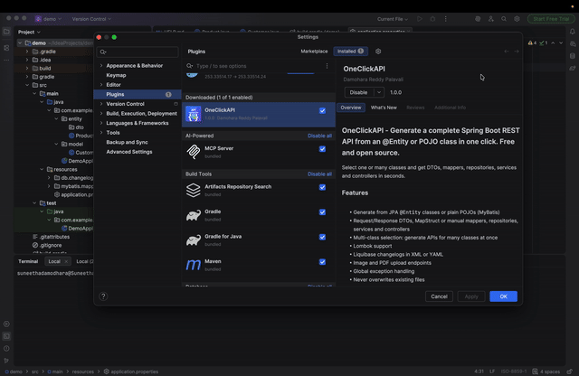

#  OneClickAPI

**OneClickAPI** is a powerful IntelliJ IDEA plugin that revolutionizes 
API development for **Spring Boot** projects. 
Generate complete REST APIs with advanced data management capabilities directly from 
**@Entity-annotated or POJO classes** with just a few clicks. 
Select multiple classes at once and generate hundreds or even thousands of APIs in seconds!

> **Free and open source (Apache-2.0).** One right-click: `Entity` → DTOs, Mapper, Repository, Service, Controller.

 <!-- add screenshot/GIF here -->

---

## Installation

### **From IntelliJ Plugin Marketplace**
1. Open **IntelliJ IDEA**
2. Navigate to **Settings > Plugins**
3. Search for **"OneClickAPI"**
4. Click **Install** and restart IntelliJ IDEA

### **Manual Installation**
1. Download the latest **OneClickAPI** release from the [Releases](#) page.
2. Open **IntelliJ IDEA** and go to **Settings > Plugins**.
3. Click **"Install Plugin from Disk"**, select the downloaded `.zip` file, and install.
4. Restart IntelliJ IDEA to activate the plugin.

---

## How It Works

1. **Install the plugin** and open your Spring Boot project.
2. **Select an** `@Entity` **or POJO class**.
3. Choose **New → Generate API** (or **Code → Generate → Generate API**, ⌘N / Alt+Insert).
4. **Configure API options** (enable file upload, DTOs, Liquibase, etc.).
5. Click **Generate**, and get **production-ready APIs** instantly!

---

##  Key Features

✅ **Automated API generation** from **JPA Entity or POJO classes**  
✅ **Auto-creation** of DTOs, Mappers, Repositories, Services & Controllers  
✅ **Lombok integration** for automatic annotations and boilerplate reduction  
✅ **Smart repository method generation** (JPA & custom implementations)  
✅ **Clean architecture enforcement** with structured package generation  
✅ **File Upload APIs:** Built-in PDF/Image upload endpoints  
✅ **Liquibase integration** for automated database schema management  
✅ **Enhanced Service Layer architecture** for business logic isolation  
✅ **Advanced global exception handling** with auto-generated error controllers  
✅ **Multi-Class Selection:** Generate APIs for hundreds of classes simultaneously  
✅ **MyBatis Support:** Generate APIs from both POJO and `@Entity` classes  
✅ **Liquibase Flexibility:** Generate database schemas in **YAML or XML**  
✅ **Highly customizable templates** for project-specific API generation  
✅ **Boosted productivity:** Reduces repetitive tasks, letting developers focus on business logic

---

##  Additional Documentation

For more details, check the following documentation files:

- **[INSTALLATION.md](./docs/INSTALLATION.md)** → Step-by-step guide for installing and setting up the plugin.
- **[FEATURES.md](./docs/FEATURES.md)** → Detailed explanation of the plugin's key functionalities.
- **[USAGE.md](./docs/USAGE.md)** → How to use the plugin effectively.
- **[LICENSE.md](./docs/LICENSE.md)** → License and usage terms.

---

## Why Choose OneClickAPI?

 **80% faster API development cycle** with automatic CRUD generation  
 **Enterprise-grade code quality** following best practices  
 **Future-proof architecture patterns** with structured code organization  
 **Seamless file handling capabilities** for PDF and image uploads  
 **Reduced maintenance overhead** with clear, well-structured code  
 **Customizable templates** to meet diverse project needs

---

## License

OneClickAPI is free and open source under the [Apache License 2.0](./LICENSE). Copyright 2026 Damohara Reddy Palavali.
---

## Support & Contributions

If you encounter any issues or have feature requests, feel free to **open an issue** in our repository or contact us. 
Contributions are always welcome!

